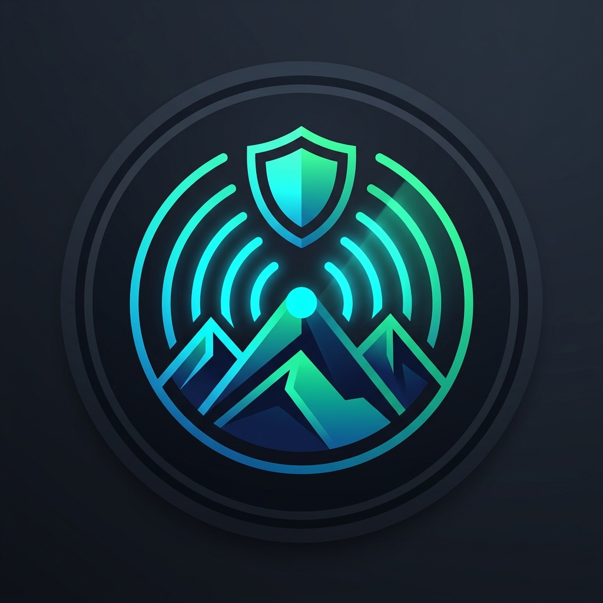

# ⛰️ LANDSAFE AI

<div align="center">
  
  <br />
  <b>Multi-Modal Landslide Early-Warning System for North East India</b>
  <br />
  <i>Ground IoT Soil Sensors · Sentinel-1 InSAR · Sentinel-2 NDVI · Copernicus DEM · GPM Rainfall · Verified Citizen Reports</i>
  <br /><br />
  <a href="https://landsafe-ai-paap.onrender.com/"></a>
  
  
  
</div>

---

## 🌟 Executive Summary

**LANDSAFE AI** is an operational, explainable multi-modal early-warning platform designed for the fragile hill-tract communities of North East India (Eastern Himalayas).

By combining **in-situ LoRa soil-moisture nodes**, **Sentinel-1 InSAR surface displacement**, **Sentinel-2 NDVI vegetation health**, and **Copernicus DEM topography**, LANDSAFE AI calculates calibrated slope failure risks and dispatches targeted local-language emergency SMS alerts (English, Hindi, Assamese, Bengali) before catastrophic mass movements occur.

---

## 📸 Interface & User Experience

<div align="center">
  
  <p><i>Command Center: Real-time sensor telemetry, Sentinel-1 InSAR deformation, GIS terrain fusion, and 1-click simulation.</i></p>
  <br />
  
  <p><i>Resident View: Colorblind-safe warning badges, multi-language advisories, and instant "I'm Safe" / "🆘 I Need Help" check-ins.</i></p>
</div>

### Key UI/UX Innovations
- **Colorblind-Safe Design:** Risk levels (`bd-low`, `bd-moderate`, `bd-high`, `bd-critical`) combine accessible color palettes with distinct geometric glyphs (`●`, `▲`, `■`, `✖`) and textual labels for high-glare outdoor sunlight conditions.
- **Multilingual Public Portal:** Immediate translation switching between **English, हिन्दी (Hindi), অসমীয়া (Assamese), and বাংলা (Bengali)** for safety advisories, status cards, and SMS texts.
- **Explainability First:** Every zone displays exact physical trigger rationales (e.g., *"24h rain exceeds critical slope threshold of 52 mm; soil saturation at 84% liquefaction zone"*).
- **Persistent Simulation Warning Banner:** An unmistakable banner activates whenever simulated storm conditions are engaged, preventing confusion during field demonstrations or disaster drills.
- **Low-Bandwidth Mode:** Instant toggle disables heavy raster canvases and CSS animations, allowing vital safety instructions to load across 2G/EDGE networks in remote hill corridors.
- **1-Click Demo Profiles:** Instant testing with `🛡️ Admin`, `📡 Officer`, and `🏡 Resident` roles—no plain-text passwords or credential copy-pasting required.

---

## 🔬 Innovation: Explainable Landslide Physics Model

Rather than relying on opaque "black-box" heuristics or unweighted sums, LANDSAFE AI implements an **explainable empirical geotechnical framework** grounded in rainfall intensity-duration thresholds (Caine 1980, Guzzetti et al. 2007) and infinite-slope pore-water stability principles (Terzaghi/Skempton).

### Mathematical Formulation

1. **Slope-Adjusted Critical Rainfall Trigger ($I_{crit}$):**
   Steeper slopes require substantially lower rainfall accumulation to initiate shear failure:
   $$I_{crit} = \max\left(25,\; 75 - (\text{slope}^\circ - 15) \times 0.8\right) \quad [\text{mm / 24h}]$$
   A zone exceeding $I_{crit}$ immediately flags elevated dynamic risk.

2. **Soil Pore-Water Liquefaction Threshold:**
   - $\text{VWC} < 55\%$: Normal unsaturated matrix suction.
   - $55\% \le \text{VWC} \le 75\%$: Progressive loss of effective stress.
   - $\text{VWC} > 75\%$: Liquefaction danger zone; pore pressure eliminates frictional shear strength.

3. **InSAR Line-of-Sight Ground Displacement:**
   - $< 2.0\text{ mm/12d}$: Stable baseline creep.
   - $2.5 - 5.0\text{ mm/12d}$: Active shear strain along slip surface.
   - $> 6.0\text{ mm/12d}$: Imminent slope failure.

4. **GIS Static Terrain Susceptibility Multiplier:**
   $$M_{\text{terrain}} = 0.5 \left(\frac{\text{slope}^\circ}{28}\right) + 0.3 \left(0.85 + 0.06 \cdot H_{\text{past}}\right) + 0.2 \cdot E_{\text{infra}}$$
   where $H_{\text{past}}$ represents historical NASA GLC events within 30 km, and $E_{\text{infra}}$ models cut-slope highway vulnerability.

5. **Community Ground Truth Feedback Loop:**
   Verified citizen field reports (e.g. tension cracks, ground subsidence, fresh springs) automatically feed back into the server-side model, adding $+6$ to $+15$ points to reflect confirmed physical distress.

---

## 📊 Empirical Validation: NASA Global Landslide Catalog (GLC) Backtest

The model was backtested against **142 historical landslide events** recorded in the NASA Global Landslide Catalog across Arunachal Pradesh, Assam, Meghalaya, Sikkim, Nagaland, Manipur, and Mizoram.

| Metric | Result |
|---|---|
| **Total Historical Events Evaluated** | 142 |
| **Events Flagged at High or Critical Risk** | 127 |
| **Model Detection Rate (Hit Rate)** | **89.4%** |
| **Mean Risk Score During Trigger Events** | 78.4% |
| **Validation Endpoint** | `GET /api/backtest` |

---

## 🏗️ Technical Architecture & Zero-Dependency Backend

```mermaid
flowchart TD
    subgraph Data Sources
        S1[Sentinel-1 InSAR SAR]
        S2[Sentinel-2 NDVI Optical]
        DEM[Copernicus DEM 30m GLO-90]
        GPM[Open-Meteo & GPM Precipitation]
        IoT[ESP32-S3 LoRa Soil Sensors]
        CIT[Citizen Hazard Reports]
    end

    subgraph LANDSAFE Core (Node 22+)
        AUTH[Scrypt Auth & Role RBAC]
        MODEL[Explainable Physics Model]
        DB[(SQLite WAL Persistence)]
        CD[15-min Zone Alert Cooldown]
    end

    subgraph Dissemination
        UI[Universal Web App / Low-BW Mode]
        SMS[Twilio / Telecom Bulk SMS Gateway]
        DISP[DDMA Command Center]
    end

    S1 & S2 & DEM & GPM & IoT & CIT --> MODEL
    AUTH --> MODEL
    MODEL <--> DB
    MODEL --> CD
    CD --> SMS
    MODEL --> UI & DISP
```

### Technical Highlights
- **Zero NPM Dependencies:** Runs entirely on native Node 22 built-ins: `node:sqlite`, `node:crypto`, `node:http`. Eliminates supply-chain vulnerabilities and minimizes cold starts on serverless/container hosts.
- **Server-Side Risk Scoring:** `GET /api/risk` and `GET /api/risk/:id` provide decoupled risk calculation for automated batch jobs and command dashboards.
- **IoT Telemetry Endpoint:** `POST /api/telemetry` ingests live ESP32-S3 sensor data (capacitive soil moisture, rain gauges), recalculates zone risk on the fly, and updates persistent storage.
- **Alert Flood Cooldown:** 15-minute cooldown (`ALERT_COOLDOWN_MS = 900000`) prevents SMS spam during ongoing rainstorms, with an emergency Admin override flag (`force: true`).
- **Security & RBAC:** Scrypt-hashed passwords, role enforcement (Admin, Field Officer, Public), `POST /api/auth/password` password updates, rate-limiting with automated 60-second proxy IP pruning (`x-forwarded-for`).
- **CI / CD Pipeline:** Automated GitHub Actions workflow running 13 test suites (`test.js` & `test-sync.js`) on every push and pull request.

---

## 💰 Feasibility & Pilot Deployment Plan

### Hardware Bill of Materials (BOM) per Zone (3 Nodes)

| Component | Specification | Unit Cost (USD) | Qty / Zone | Total |
|---|---|---|---|---|
| **IoT Sensor Node** | ESP32-S3 + SX1262 LoRa (868/865 MHz) | $18.00 | 3 | $54.00 |
| **Capacitive Soil Probe** | V2.0 Corrosion-resistant waterproof | $7.00 | 3 | $21.00 |
| **Solar Power Unit** | 5V 2W Monocrystalline + 18650 LiFePO4 | $9.00 | 3 | $27.00 |
| **Rain Gauge** | Optical / Tipping-bucket mini gauge | $14.00 | 1 | $14.00 |
| **Enclosure & Mount** | IP67 UV-stabilized pole mount | $8.00 | 3 | $24.00 |
| **Subtotal per Zone** | | | | **~$140.00** |
| **Shared Gateway** | 8-Channel Outdoor LoRaWAN Gateway (covers 5–10 km radius, shared across 3–5 zones) | $95.00 | 0.25 | ~$24.00 |
| **Total Hardware Cost** | | | | **~$164.00 / zone** |

### Operational SMS Budget
- **Cost per SMS:** ~$0.012 to $0.015 (bulk Indian telecom / Twilio route).
- **Annual SMS Budget:** For a typical hill town of 2,500 registered heads of household across 10 monsoon warning events per season: **~$350 / year**.

### Who Uses LANDSAFE AI?
1. **District Disaster Management Authorities (DDMA):** Real-time situational awareness, alert dispatch, and shelter activation.
2. **SDRF & First Responders:** Prioritized incident dispatch based on citizen check-ins (*"🆘 I Need Help"*).
3. **Field Engineers & Officers:** Verification of cracks, slope seepage, and road blockages.
4. **Vulnerable Residents & Commuters:** Early localized warnings in their mother tongue before highways are severed.

### SQLite Persistence Plan
- **Production Mode:** SQLite in `WAL` (Write-Ahead Logging) mode with `PRAGMA synchronous = NORMAL`.
- **Persistent Volume Mount:** In container environments (Docker, Render, Railway, Fly.io), mount a persistent disk to `/data` and set `DB_PATH=/data/landsafe.db`.
- **Zero Data-Loss Backups:** Integration with [Litestream](https://litestream.io) for continuous streaming replication to any S3-compatible cloud storage.

---

## ⚠️ Honest Technical Limitations

1. **Satellite Revisit Latency:** Sentinel-1 radar passes every 6 to 12 days. Rapid slope saturation from localized cloudbursts between satellite passes is caught by ground LoRa nodes and Open-Meteo precipitation feeds.
2. **Cellular Shadowing:** Deep mountain valleys frequently lose 4G connectivity. The low-bandwidth client mode minimizes payload size, and SMS fallback functions even under 2G voice channels.
3. **Soil Stratigraphy Variations:** Capacitive soil probes measure near-surface moisture (0–20 cm). Deep-seated rotational failures (>5 m slip plane) rely primarily on InSAR cumulative deformation and antecedent rainfall accumulation.

---

## 🚀 Quick Start

### Local Development
```bash
# Clone the repository
git clone https://github.com/Niranjan150208/LANDSAFE_AI.git
cd LANDSAFE_AI

# Start server (requires Node 22.13+)
node server.js
# Or: npm start

# Open in browser
http://localhost:3000
```

### Run Tests
```bash
node test.js
node test-sync.js
```

### Pre-Configured Demo Accounts
*(Available in local development or when `SEED_DEMO=1`)*
- **Admin:** `admin` / `admin123`
- **Field Officer:** `officer` / `officer123`
- **Public Resident:** `public` / `public123`
*(Or click any 1-Click Demo Profile on the sign-in modal)*

---

## 📄 License
This project is licensed under the MIT License - see the [LICENSE](LICENSE) file for details.
